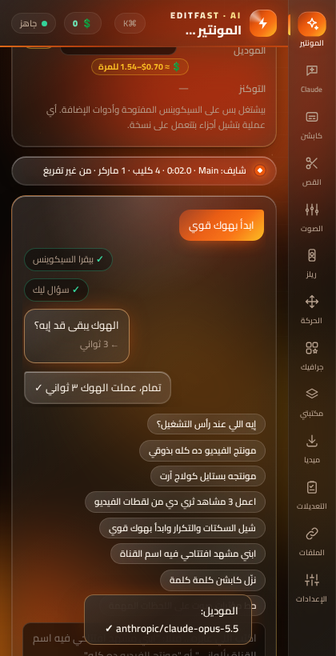
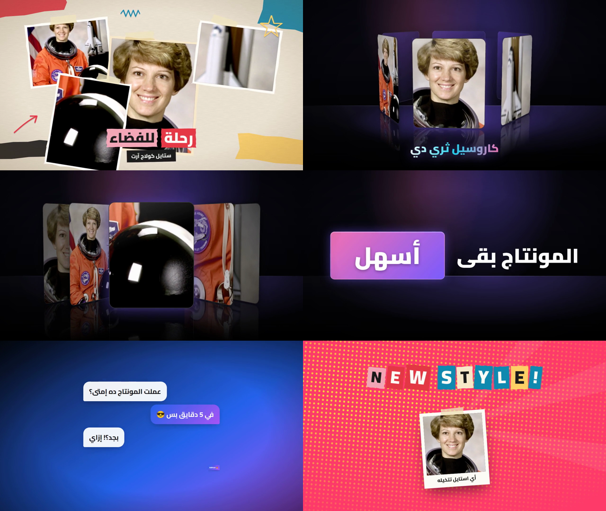

# EditFast — إضافة مونتاج ذكية لـ Adobe Premiere Pro

لوحة جوه بريمير فيها مونتير ذكي بتكلّمه، و26 أداة مونتاج. معظم الشغل **أوفلاين على جهازك** (القص، التفريغ، المالتي كام، التنظيم، الإيقاع، الحركة، المنحنيات، المكتبة)، والذكاء الاصطناعي كله بيعدّي من **OpenRouter بمفتاحك** وانت بتختار الموديل لكل ميزة.





## التثبيت

1. نزّل `EditFast-2.0.0.zip` وفكّه.
2. **ويندوز:** دبل كليك على `scripts/install-windows.bat`
   **ماك:** دبل كليك على `scripts/install-mac.command` (لو اترفض: كليك يمين > Open)
3. افتح بريمير ← `Window > Extensions > EditFast`

المثبّت بيعمل:
- ينسخ الإضافة لفولدر إضافات أدوبي.
- يفعّل `PlayerDebugMode` (لازم عشان الإضافة مش موقّعة من أدوبي).
- يثبّت **ffmpeg** و **whisper.cpp** و **yt-dlp** (ويندوز: winget + ريليس whisper.cpp — ماك: Homebrew).

محتاج **Premiere Pro 2021 (15.0) أو أحدث**.

## أول مرة (من تبويب ⚙️ الإعدادات)

| الحاجة | لازم؟ | ليه |
|---|---|---|
| مفتاح **OpenRouter** | للمونتير الذكي وكل مميزات الـ AI | [openrouter.ai/keys](https://openrouter.ai/keys) |
| موديل **Whisper** | للتفريغ | زرار "حمّل الموديل" (مرة واحدة — Large v3 Turbo الأدق للعربي) |
| مفتاح **ElevenLabs** | لتوليد المؤثرات الصوتية | [elevenlabs.io](https://elevenlabs.io/app/settings/api-keys) |
| مفاتيح **Pexels / Pixabay** | لمكتبة B-Roll وبحث النت | مجانية |
| مفتاح **Google Custom Search** + رقم المحرك (cx) | اختياري: نتايج Google جوه بحث النت | [مجاني 100 بحث/يوم](https://developers.google.com/custom-search/v1/introduction) |
| **yt-dlp** | للتحميل من يوتيوب/إنستجرام/تيك توك | المثبّت بيثبّته |
| **Node.js** + محرك Remotion | للمشاهد Pro | المثبّت بيثبّتهم (مرة واحدة ~200MB)، أو من تبويب مشاهد Pro |
| ملف **MOGRT أساسي** | عشان التايتلات تتعدّل من Essential Graphics | بيتلاقى لوحده من فولدر بريمير، أو اختاره |

**الموديلات:** في الإعدادات فيه لوحة "🤖 الموديلات لكل ميزة" — دوس "حمّل قائمة الموديلات من OpenRouter" واختار لكل ميزة الموديل اللي يشغّلها (أو موديل عام للكل). وكل تبويب فيه AI عنده نفس المختار فوق. المفاتيح والإعدادات بتتحفظ على جهازك بس في `~/.editfast`.

## الجديد في 2.0.0 — استوديو موشن كامل جوه أفتر
اتعمل بعد ما دوّرنا على أشهر الإضافات (Duik، RubberHose، Joysticks 'n Sliders، Mocha، Element 3D، Overlord، Flow، Saber، Explode Shape Layers، Ray Dynamic Color، Plexus) — وده اللي بقى جوه EditFast Motion من غير بلاجنز:
- **🖋 لوجو ← مسارات (Image Trace):** أي PNG / JPG بيتحوّل لمسارات بيزيير ناعمة بألوانها (والفتحات جوه الحروف بتفضل)، وأي SVG بيتقري بأشكاله وألوانه.
- **أنيميشن لوجو:** بيترسم بخط وبعدين يتملي (Trim Paths)، خط بس، نيون منوّر بيرعش، الأجزاء بتتبني ورا بعض، أو **ثري دي مجسّم** (Extrude + Bevel) بكاميرا وإضاءة.
- **مورف (زي ShapeShifter):** بين أي أشكال أو كلام (بيتحوّل Outlines لوحده) أو لوجوهات من ملفات — النقط بتتظبط وتتقابل، والألوان بتتحوّل كمان، ولوب.
- **صورة ← ثري دي:** خريطة عمق ← طبقات ← كاميرا بتتحرك (داخلة / بتلف / طالعة / طافية). العمق من fal.ai (لو فيه مفتاح) أو ملف عمق أو تقدير بالـ AI. و**موديل ثري دي حقيقي** من صورة (fal.ai، أفتر 2024+).
- **🎯 تراكينج:** دوس على الفريم وحط نقطة (مكان)، نقطتين (مكان + سكيل + لف)، أو 4 (Corner Pin لاستبدال شاشة)، أو قول "الوش / الموبايل" والـ AI يلاقيه. بعدها: ليرز وكلام يمشوا مع الحاجة، أو شاشة جديدة، أو **تثبيت الفيديو**.
- **🧍 كاراكتر أنيميشن:** كاراكتر فلات بأطراف مطاطية متريّج جاهز (مشي، جري، تلويح، كلام، نط) بسلايدرز. و**ريج لكاراكترك** (PSD / AI بأسامي إنجليزي أو عربي): أنكر في المفاصل، بارنتنج، **IK حقيقي** للإيدين والرجلين، مشي وتنفّس ورمش.
- **ليب سينك** من ملف صوت، و**Audio React** (أي لير ينبض مع المزيكا).
- **أدوات الشغل اليومي:** محاذاة وتوزيع، ترتيب الليرز ورا بعض في الوقت، فصّل جروبات الشيب لليرز، كنترول واحد لكل ألوان الكومب، وإكسبريشنز Squash & Stretch وبندول.
- **المونتير الذكي** بقى يقدر يستخدم الكاراكتر والـ Plexus والثري دي المجسّم في المشاهد اللي بيعملها.

## الجديد في 1.9.0 — المونتير بقى بيعمل موشن ديزاين حقيقي
- **أشكال وأيقونات بأي مسار (SVG):** لوجوهات وأيقونات وخطوط منحنية — وMorph من شكل لشكل بالكي فريمز.
- **خطوط بتترسم (Trim Paths)** ونقط/داش وأطراف مدوّرة، و**Repeater** (بيرست، أنماط، لودرز).
- **ماسكات** (مستطيل/دايرة/مسار، فيذر، Expansion متحرك) و**Track Matte** (كلام طالع من ورا شكل) — بيشتغل على الأفتر الجديد والقديم.
- **جرادينت** خطي ودائري في الأشكال.
- **بري كومب:** مشاهد جوه مشاهد — فيديو كامل من كذا مشهد بترانزيشن.
- **Particles من غير بلاجن:** تراب، تلج، شرار نار، سباركس، كونفيتي، بوكيه، نجوم.
- **أي إفكت متسطب:** 25 إفكت بالاسم (Fractal Noise، Light Rays، Wipes، Echo، Tritone…) + أي بلاجن عندك (Saber، Deep Glow…) — بيعرف البلاجنز المتسطبة لوحده.
- **كاميرا** بعمق ميدان (DOF / Focus / Aperture) و**إضاءة** بإعداداتها، وأنيميشن خروج للكلام وعدّاد بـ prefix/suffix.
- **بيراجع شغله:** بعد ما يبني بيصوّر 4 فريمات من الكومب ويبصّلها زي آرت دايركتور ويصلّح اللي مش مظبوط (كلام صغير أو طالع برّه، ألوان، فراغ).
- **الريفرانس أدق:** 8 لقطات من الفيديو بتوقيتها + إيقاع القطعات.
- **6 مشاهد جاهزة جديدة:** لوجو بيترسم، عنوان بشرار، بلوب بيتشكّل، كلام بيطلع من ورا خط، بيرست، برومو 3 مشاهد بترانزيشن.
- تعديلات جديدة في الشات: استبدال لير كامل، تغيير طول الكومب.

## الجديد في 1.8.0 — المونتير الذكي في أفتر
- **🎬 المونتير** (تاب جديد في EditFast Motion): وصّف المشهد بالمصري ← بيبني كومب بليرز حقيقية (كلام، أشكال، سوليد، نل، كاميرا، إضاءة، فوتيج) وكي فريمز بمنحنيات احترافية وإفكتات (جلو، بلور، شادو، جرادينت…) وText Animators — كلها تتعدّل بإيدك.
- **كمّل معاه في الشات:** "كبّر العنوان"، "خلّيها أبطأ"، "غيّر اللون لأزرق"، "ضيف شكل"، "شيل الدايرة" ← بيعدّل نفس الليرز بأساميها. كل خطوة Undo واحد.
- **ريفرانس:** ابعتله صورة أو فيديو (بياخد منه 4 لقطات) ← بيحلّل الألوان والخط والتكوين والحركة ويعمل مشهد قريب منه.
- **مشاهد احترافية جاهزة:** عنوان كاينتك، ظهور لوجو، إنترو سوشيال، اقتباس، عدّاد أرقام، زرار اشترك، كول آوت، فتح من النص، جليتش، كروت ثري دي بكاميرا — اكتب كلامك ولونك وبس.
- **منتج الفيديو لوحده:** اختار اللقطات والمزيكا والستايل (حماسي / سينمائي / فلوج / هادي) والمقاس ← بيشوف اللقطات ويرتّبها ويختار أحلى لحظة، يقطع على البيت، ويحط زووم وترانزيشن وعناوين وجريد — في كومب جديد تعدّل عليه.
- الـ AI بيكتب **وصف** المشهد بس، والإضافة هي اللي بتبنيه — مفيش كود من برّه بيتشغّل في الأفتر.

## الجديد في 1.7.2

- **اتصال EditFast Motion بالأفتر:** سكريبت الأفتر بقى بأسماء خاصة بيه (الأفتر بيشارك محرك السكريبت بين كل الإضافات، فممكن إضافة تانية تتلخبط معاه). لو مش متصل، دوس على الحالة فوق تشوف السبب بالظبط وتتصل تاني، وفي الإعدادات فيه كارت "الاتصال بالأفتر". والإضافة بتنبّهك لو الأفتر مش سامح للسكريبتات تكتب ملفات (Settings ← Scripting & Expressions ← Allow Scripts to Write Files and Access Network) — لازمة لحفظ القوالب والريندر.

## الجديد في 1.7.1

- **EditFast Motion بقى إضافة لوحده لأفتر** (فولدر EditFastMotion جنب EditFast) — ده الشكل اللي أدوبي بتدعمه. بيتعمل ويتحدّث لوحده أول ما تفتح EditFast في بريمير (أو من المثبّت)، وبعدها اقفل الأفتر وافتحه: Window ← Extensions ← **EditFast Motion**.

## الجديد في 1.7.0 — EditFast Motion لأفتر إفكتس

نفس التثبيت بقى بيشتغل في **After Effects** كمان: Window ← Extensions ← **EditFast Motion**. المكتبة والإعدادات والمفاتيح واحدة مع بريمير.

- **قوالبي (أفتر → بريمير):** اعمل الحاجة، دوس "احفظ كقالب لبريمير"، والإضافة بتسألك إيه اللي يتعدّل في بريمير: **الكلام / الألوان / الحركة (سرعة وقوة) / المكان والحجم / الكنترولز بتاعتك / الصور**، أو اختيار جاهز (حركة بس، لون وحركة، كلام ولون، كله). بتعمل نسخة من الكومب (الأصل مابيتلمسش)، كل لون مستخدم بيبقى خانة واحدة (الأشكال اللي بنفس اللون بتتغير مع بعض)، وسلايدر سرعة وقوة بيتحكموا في كل الأنيميشن. القالب بيطلع MOGRT في فولدر قوالب بريمير — يظهر في Essential Graphics وفي EditFast ← جرافيك ← **قوالبي من أفتر**، وهناك تكتب الكلام وتغيّر الألوان والسلايدرز قبل ما يتحط. "افتحه" و"حدّث" يرجعوك تعدّل في أفتر ويتحدّث في بريمير.
- **الحركة:** 28 حركة جاهزة بكي فريمز ومنحنيات حقيقية، **منحنيات زي Flow** على الكي فريمز المختارة (أو cubic-bezier بإيدك)، ستاجر، الأنكر بوينت في 9 أماكن من غير ما اللير يتحرك، نل كنترولر.
- **الكلام والأشكال:** Text Animators (طالع، آلة كاتبة، ضباب، بوب، من الجنب، مسافات) حرف/كلمة/سطر، **لوور ثيرد في ثانية**، أشكال جاهزة.
- **إكسبريشنز بضغطة بسلايدرز:** Wiggle، Bounce، Loop، رايح جاي، فيد تلقائي، طفو، لف، فليكر، آلة كاتبة.
- **ثري دي:** كاميرا جاهزة على Rig (دخول، لف، جنب، في الإيد)، **بارالاكس** بيوزّع الليرز في العمق ويحافظ على حجمها، إضاءة وظلال، كلام وأشكال بسُمك (Advanced 3D).
- **الروتين:** ريندر MP4 / شفاف / ProRes (أو Media Encoder) ويظهر في بريمير تحت "من أفتر"، تبديل الألوان في الكومب كله، تنضيف المشروع وترتيبه.
- **مساعد الموشن:** اكتب اللي عايزه ("لوور ثيرد باسمي والكلام يتكتب وكاميرا داخلة") يطلعلك خطوات تشوفها وتنفّذها.
- **⌘K** في أفتر كمان.

## الجديد في 1.6.2

- **تصميم جديد "Ember" برتقالي بدرجاته:** من الصدأ الغامق للبرتقالي المحروق للمشمشي والذهبي — جمرات صغيرة طالعة في الخلفية، خط برتقالي سايح تحت الشريط اللي فوق، والأزرار والمنحنيات والاختيارات كلها برتقالي، وأيقونة جديدة في قائمة بريمير.

## الجديد في 1.6.1

- **التحميل مابقاش يعلّق:** لو التحميل وقف في النص (45 ثانية من غير تقدّم) أو الموقع مابيردّش (75 ثانية)، بيوقفه على طول ويجرّب الطريقة اللي بعدها بدل ما يستنى دقايق ويقول خطأ. yt-dlp بقى بيسيب المحاولة بسرعة (مهلة 15 ثانية و3 محاولات بس)، وبينزّل 4 أجزاء مع بعض (إنستجرام وتيك توك وX أسرع). تجربة تسجيل الدخول من المتصفحات بقت لمتصفحين بس. شريط الحالة بيوريك السرعة والوقت الباقي. ودروبوكس/درايف: الاتصال الميت بيتقفل بعد دقيقة مش 10.

## الجديد في 1.6.0 — مميزات أقوى البلاجنز في السوق

- **قصة واحدة ← كل المقاسات** (ريلز): علّم In/Out واختار 16:9 و4:5 و9:16 و1:1 — كل مقاس سيكوينس لوحده والكاميرا متابعة الوش.
- **زووم تلقائي من الصوت** (الحركة): بيلاقي الجمل اللي بتأكد فيها ويعمل عليها زووم (قطع يوتيوب / دفعة ناعمة / بانش) — من غير AI ومجاني، وفيه "علّم الأماكن بس".
- **مربع الأوامر ⌘K**: اكتب أي أداة أو أمر أو إفكت بريمير (بالعربي أو الإنجليزي: "بلور"، "Cross Dissolve") ويتنفّذ على الكليبات المختارة.
- **الإعادات (أحسن تيك)** (القص): الجمل اللي اتعادت أو اتسابت في النص، متجمّعة ومتختار أحسن تيك، تسمع كل تيك وتغيّر قبل القص.
- **انسخ والصق الإفكتات** (الحركة): كل الإفكتات والكي فريمز من كليب لكليبات كتير، والكي فريمز بتتمطّ على طول كل كليب.
- **تنظيم المشروع** رجع تحت "الملفات".
- **مالتي كام أذكى**: "أطول مدة لقطة" — لو حد اتكلم كتير بيقطع للواسعة أو لوش التاني وبيرجع، واللقطة الواسعة ممكن تبقى من غير مايك. واتصلح إن اللي بيتكلم من غير وقفات كان بيتحسب ساكت.
- **مونتاج على البيت** (بحث وماركرز): الكليبات بتتقص على الإيقاع (1/2/4/8 بيت لكل كليب) على نسخة.
- **قوالب كابشن جاهزة**: هرموزي بوب، بوكس بوب، بيست ملوّن، كاريوكي تيك توك، بودكاست هادي، نيون، وثائقي وغيرهم — ضغطة واحدة.

## الجديد في 1.5.9

- **زرار "⏹ وقف التحميل":** بيظهر وانت بتحمّل. بيوقف التحميل على طول (yt-dlp والـ ffmpeg اللي معاه، أو تحميل دروبوكس/درايف)، بيمسح الملفات اللي اتحمّلت نص نص، ومابيحطش حاجة على التايملين. لو كنت حاطط كذا لينك، اللي بعده مش هيبدأ.

## الجديد في 1.5.8

- **الكابشن مابقاش متأخر:** whisper بيحط الكلمات متأخرة شوية ومش بنفس المقدار كل مرة، فدلوقتي الإضافة بتسمع الصوت نفسه وبتخلّي كل جملة تبدأ مع أول صوتك بالظبط (كابشن بريمير، الثابت، المتحرك، الترجمة وملف SRT). الاختيار "اربط كل جملة ببداية الصوت" شغال من الأول، والإزاحة القديمة اتصفّرت مرة واحدة عشان ماتأخرش الكابشن تاني.
- **مكتبتي:** الملفات اللي اتضافت لوحدها بقت خانة واحدة ("📄 N ملف لوحده") بدل خانة لكل ملف، وتقدر تشيلها كلها بضغطة، أو "🗑 شيل الكل" تفضّي المكتبة (من غير ما يتمسح حاجة من الجهاز).
- **MOGRT في مكتبتي:** بتظهر بصورتها، ولما تدوس عليها تكتب الكلام اللي هيظهر فيها قبل ما تحطها.

## الجديد في 1.5.7

- **البريفيو اشتغل جوه بريمير:** المتصفح اللي جوه بريمير مابيشغّلش فيديو H.264، فالبريفيو بقى بيتعمل WebM (صوت وصورة، 360p) بقطع 20 ثانية والقطعة الجاية بتتجهّز وانت بتتفرج. لو الأصلي يقدر يشتغل على طول بيشتغل، ولو مابدأش في 8 ثواني بيحوّل لوحده.
- **الكابشن بيمشي مع تعديلاتك:** لو حرّكت أو قصّيت أو سرّعت كليب بإيدك بعد التفريغ، الكلام بيتحط تاني على مكانه الجديد (من غير تفريغ تاني، وتصليحاتك للكلام بتفضل). قبل كده الكابشن كان بينزل بمواعيد التايملين القديمة.

## الجديد في 1.5.6

- **بريفيو بالصوت والصورة قبل التحميل:** بعد "حلّل اللينك" دوس "▶ بريفيو بالصوت والصورة" — الفيديو بيشتغل جوه الإضافة (دروبوكس، جوجل درايف، يوتيوب وغيرهم). اتفرّج ودوس **"خلّي ده البداية"** و**"خلّي ده النهاية"** عند اللحظة اللي انت فيها، و"▶ شغّل الجزء" يشغّل اللي اخترته ويقف عند آخره. لو ملف دروبوكس بصيغة مش بتشتغل في الإضافة (HEVC / ProRes) بيعمل بريفيو مخفف 360p بالصوت لوحده، والتحميل بينزل بالجودة الأصلية.

## الجديد في 1.5.5

- **بريفيو لدروبوكس وجوجل درايف:** بعد "حلّل اللينك" بتظهر صورة من الفيديو، وتحت الشريط صورتين لأول وآخر الجزء اللي اخترته بيتحدّثوا وانت بتحرّك — تتأكد إنك واخد المشهد الصح قبل ما تنزّل.

## الجديد في 1.5.4

- **دروبوكس وجوجل درايف:** الصق لينك المشاركة في "تحميل" ودوس "حلّل اللينك": هيقرا اسم الملف وحجمه ومدته من غير ما ينزّله. اختار الجزء من الشريط وهو بينزّل **الجزء ده بس** (ffmpeg بيقرا من اللينك ويقص) — مثلًا 3 دقايق من مقابلة 2 جيجا من غير ما تستنى الملف كله. لو السيرفر مارضيش ينطّ جوه الملف بينزّل الملف كله ويقصه على جهازك. لينك فولدر دروبوكس: بينزل كله، يتفك، يتضاف لمكتبتي ويتعمله Bin في بريمير. اللينك لازم يكون "Anyone with the link".

## الجديد في 1.5.3

- **تزامن الكابشن:** الكليبات المسرّعة (110% مثلًا) بقت تتحسب صح (قبل كده الكابشن كان بيتأخر أكتر كل ما الكليب يطول). التفريغ بقى بيسمع الكلام بس (Silero VAD جوه الإضافة) فمابيطلّعش كلام وقت السكوت والمزيكا، والتوقيت بيتربط بالصوت. خطوة ظبط الكلمات على السكتات بقت بتمشي مع مستوى صوتك (الصوت الواطي مابقاش يتحسب سكوت) ومابتحركش كلمة أكتر من 0.6 ثانية. وجديد: **"اضبط التزامن تلقائي"** بيقيس الفرق بين الكابشن والصوت ويظبطه، وشريط تقدّم/تأخر بإيدك.

## الجديد في 1.5.2

- **التحميل (403 ويوتيوب وإنستجرام):** لو yt-dlp اللي على الجهاز قديم (أقدم من شهر ونص) الإضافة بتنزّل أحدث نسخة لوحدها أول مرة. لو يوتيوب رفض (403) بتجرّب طريقة تانية لوحدها، ولو الرفض جه من القص أثناء التحميل بتنزّل الفيديو كله وتقصّه على جهازك بالظبط. لو الموقع (إنستجرام، تيك توك، X…) طلب تسجيل دخول بتجرّب تسجيل دخولك من المتصفحات اللي عندك (Chrome الأول) وبتفتكر اللي اشتغل. ورسالة الخطأ بقت باسم الموقع الصح.

## الجديد في 1.5.1 (قبلها)

- **الفحص اتصلح:** نسخة 1.5.0 كانت بتجرّب الاستيراد بصورة PNG بايظة، فبريمير كان بيرفضها صح، والفحص كان بيقول إن كل حاجة مش شغالة. دلوقتي الصورة سليمة، وكل ملف بيتجرّب لوحده (فيديو في فولدر اسمه عربي، صورة، كابشن)، والحاجة اللي ماتجرّبتش بتظهر "ما اتجرّبش" بالأصفر مش "مش شغالة".
- **مكتبتي رجعت أداة لوحدها في الشريط الجانبي وبقت أقوى:** أقسام بعددها (ساوند إفكتس، موسيقى، ترانزيشنز، أوفرلايز، لقطات، جرافيك/MOGRT، صور، بريسيتس) وتحتها أنواع (ووش، ضربات، بوب…)، صورة مصغّرة لكل فيديو وموجة صوت لكل ساوند (حتى ProRes وHEVC اللي البانل مابيعرضهاش)، ⭐ المفضلة و🕘 الأخيرة والأكتر استخدامًا، تاجات بتاعتك بتلاقيها بالبحث، تسحب أي حاجة على التايملين، دبل كليك أو ＋ يحطها عند رأس التشغيل، "على كل الماركرز" مرة واحدة، عند الـ In، MOGRT بينزل كجرافيك تعدّله، "افتح مكانه" في Finder، إدارة فولدرات المكتبة، والتحديث سريع (الملفات اللي ماتغيّرتش مابتتقريش تاني).

## الجديد في 1.5 — اتظبطت عشان تشتغل على بريمير الحقيقي

- **الفحص (الإعدادات ← الفحص):** زرار "افحص بريمير بتاعي" بيجرّب كل أمر الإضافة بتستخدمه على سيكوينس تجربة وبيمسحها، وبيقولك أنهي أداة جاهزة وأنهي لأ وليه. وزرار "انسخ تقرير المشكلة" بينسخ تقرير (من غير مفاتيحك) تبعته. كل خطأ بيتسجل في `~/.editfast/logs`، ورسالة الخطأ لما تدوس عليها بتوديك للفحص.
- **11 أداة بدل 28 تبويب:** كل أداة فيها الشاشات اللي بتعمل حاجات قريبة من بعض (مثلًا "جرافيك" = القوالب والتايتلات والأيقونات والكاروسيل والجلاس والثامبنيل). اتشال: تنظيم المشروع (كان بيبعتر فولدراتك)، توليد المزيكا، بحث جوجل، وخطوة الهوك التلقائي (بقت ماركر بس).
- **الأساس:** الاستيراد مابقاش يلف على المشروع كله مع كل ملف (كان بيهنّج بريمير)، والكليب بيتحط بطوله الحقيقي من غير ما يغطي كليباتك، ولو مفيش تراك فاضي بيقولك بدل ما يكتب فوق شغلك، والقص بيتأكد إنه شغال على النسخة، وكل أمر لبريمير ليه حد زمني ورسالة واضحة. أسماء الملفات العربي على الماك بقت تتقري صح.
- **الكابشن العادي من غير أنيميشن:** "كابشن بريمير" بينزل تراك كابشن جوه بريمير تعدّله من غير رندر (ومعاه دليل لو العربي ظهر مفكك)، و"ثابت بالشكل" بينزل كل الكروت على تراك واحد في استيراد واحد. التفريغ: تختار تراك الكلام، وكل ملف بيتفرّغ مرة واحدة حتى بعد القص، وتصحّح الكلمات بدبل كليك.
- **التحميل:** الإضافة بتنزّل نسختها من yt-dlp لوحدها وتحدّثها بزرار، وبتلاقي deno/node اللي يوتيوب محتاجه، وكوكيز المتصفح لو يوتيوب طلب تسجيل دخول، وكذا لينك مرة واحدة، ولو الدمج أو القص فشل بتجرّب طرق تانية لوحدها. الأخطاء بالعربي وبتقول تعمل إيه.
- **من السوق (AutoCut / FireCut / TimeBolt / Descript):** شيل كلمات الحشو (اممم، آآآ، ويعني لو عايز)، القص بالكلام (تشطب كلام في التفريغ يتشال من التايملين)، القص بماركرز الأول تراجعها، تشيل علامة من سكتة تحب تسيبها، ماتقصّش تراك المزيكا، باقة النشر على يوتيوب (5 عناوين + وصف بالفصول + تاجات)، وبيب/كتم على كلمات معيّنة. والمونتير الذكي بقى يقدر يعملهم.
- **الحركة:** قوالب الحركة بتكتب 2–12 كي فريم بإيزينج تقدر تعدّلهم بدل كي فريم لكل فريم. توطية المزيكا مرتين مابقتش توطّي مرتين.

> كل ده اتجرّب على محاكي لبريمير وعلى اختبارات (200+ اختبار)، مش على بريمير الحقيقي. أول حاجة بعد التحديث: الإعدادات ← **افحص بريمير بتاعي**، ولو فيه أحمر ابعتلي التقرير.

## الأدوات

| الأداة | بيشتغل | إزاي |
|---|---|---|
| ✨ **المونتير الذكي (EditFast AI)** | OpenRouter | تكتبله اللي عايزه. يسألك عن ذوقك (ألوان، خط، إيقاع، كابشن، مؤثرات) **مرة واحدة** ويحفظه، ويقرر كل فيديو محتاج إيه: يشيل التكرار والسكتات، يبدأ بهوك، يبني مشاهد متحركة بألوانك، كابشن ومؤثرات على الكلمة. مستويين: **قوي** و**قوي جدًا** (بيخطط ويراجع نفسه) — وكل مستوى بالموديل اللي تختاره. شغلته المونتاج والمشروع ده بس. |
| ✂️ **القص السريع** | أوفلاين | بيسمع الصوت (ffmpeg) ويلاقي كل سكتة ويشيلها ويقفّل الفراغ على كل التراكات. حساسية 1-10، هامش للكلام، و**انتقال صوتي** (Constant Power) عند كل قصة. بيشتغل على نسخة من السيكوينس. |
| 🎇 **المؤثرات التلقائية** | OpenRouter + ElevenLabs | الموديل بيقرا التفريغ ويفهم بيحصل إيه (مفاجأة، رقم، نكتة، انتقال) ويقترح صوت أو حركة لكل لحظة — تراجع وتشيل اللي مش عاجبك وتطبّق. |
| 🔊 **مؤثرات صوتية** | ElevenLabs | تكتب الوصف بالعربي، زرار يترجمه للإنجليزي، ويتولّد الصوت ويتحفظ على جهازك وتنزله عند رأس التشغيل. |
| 📝 **تفريغ الكلام** | أوفلاين (whisper.cpp) | توقيت **لكل كلمة** متظبط على الصوت نفسه (محاذاة DTW + Beam Search للكلام الأدق + الكلمة مابتبدأش جوه سكتة، وبيستخدم كل أنوية الجهاز). 7 لهجات (مصري، خليجي، شامي، عراقي، مغربي، فصحى، English). بعده تصحيح إملائي تلقائي (قواعد أوفلاين للهمزات والعبارات + الموديل لو فيه مفتاح، من غير ما التوقيت يبوظ). |
| 💬 **الكابشن** | أوفلاين | بينزل SRT على التايملين كـ caption track تعدّله من تبويب Text. عدد الكلمات، أقصى مدة، ووضع كلمة واحدة في الكارت. |
| 🎥 **المالتي كام** | أوفلاين | بيحلل صوت مايك كل كاميرا ويعرف مين بيتكلم، ويطلّع خطة تبديل (أقل مدة لقطة + لقطة واسعة اختيارية) **تراجعها وتعدّلها** قبل التطبيق. |
| 🗂️ **تنظيم المشروع** | أوفلاين | بيمسح المشروع ويوريك الخطة (فيديو، صوت/موسيقى، صوت/مؤثرات، صور، جرافيك، كابشن، سيكوينسات) قبل ما يلمس حاجة. |
| 〰️ **محرر المنحنيات** | أوفلاين | بيقرا الكي فريمز اللي على الكليب ويرسمها، تختار شكل الحركة (Expo، Back، Elastic، Bounce أو تسحب نقط البيزيير بإيدك) وهو يعيد كتابة الحركة كلها فريم بفريم. |
| 📚 **مكتبتك** | أوفلاين | ارمي الفولدر كله وهو يرتّب الساوند إفكتس (whoosh / impact / pop / riser…) والترانزيشنز والأوفرلايز والموسيقى لوحده. حط الماوس تسمع/تشوف، دبل كليك ينزل عند رأس التشغيل. |
| 🎬 **قوالب الحركة** | أوفلاين | **28 قالب** (12 دخول، 7 خروج، 9 تأكيد) بيكتبوا كي فريمز حقيقية على **Transform** تفتحها في Effect Controls وتعدّلها، و**3 مستويات قوة**. |
| 🔤 **تايتلات متحركة** | أوفلاين | **25 قالب**. ينزل عند رأس التشغيل كجرافيك تعدّل نصه من Essential Graphics، والحركة كي فريمز على الكليب. |
| 💧 **Liquid Glass** | أوفلاين (WebGL) | الستايل المشهور: زجاج سايل **بيكسر ويغبّش الفيديو اللي تحته فعلًا** — حواف لامعة، ألوان على الحواف، ظل، وحركة دخول سايلة. 10 ستايلات (كبسولة، كارت، عدسة مكبّرة، لوور ثيرد، إشعار، زرار اشترك، نص زجاج، شريط أيقونات، بانل جانبي، إطار) وكل حاجة فيهم بتتظبط (التغبيش، الانكسار، التكبير، اللون، اللمعة، الحركة). بيقرا فريمات الكليب اللي تحت رأس التشغيل وينزل طبقة ProRes 4444 شفافة فوقه بالظبط. والمونتير الذكي يقدر يعمله برضه. |
| ⚡ **مونتاج تلقائي بضغطة** | AI + أوفلاين | خطة تراجعها وتشيل منها اللي مش عايزه: تفريغ ← تكرار ← سكتات ← هوك يختاره الذكاء الاصطناعي ← تنضيف صوت ← زووم ← B-Roll على الكلام ← مؤثرات ← توطية موسيقى ← كابشن متحرك. كل خطوة بتبان حالتها، و**كل حاجة بتتسجل وترجع بزرار واحد**. |
| 🎞 **مشاهد Pro (Remotion)** | أوفلاين بعد التثبيت | محرك موشن جرافيك احترافي: **26 مكوّن** — عناوين حركية، تظليل، اقتباس، أرقام، رسوم، قوائم، خطوات، لوور ثيرد، لوجو، اشترك، بوست سوشيال، إيموجي، **كولاج صور، حروف مقصوصة، شخابيط يد، بولارويد، كاروسيل ثري دي، كارت ثري دي، مكعب كلمات، نص ثري دي، لقطة بزووم، إشعار موبايل، شريط بحث، محادثة، متصفح، أيقونة** — و9 خلفيات (منهم ورق، هالفتون، استوديو ثري دي). **المخرج الذكي** بيصمم المشهد من وصفك وبالاستايل اللي تختاره، وبيستخدم **لقطات من الفيديو بتاعك** في الكولاج والثري دي. |
| 🎨 **مونتاج بالاستايل** | AI + Remotion | **24 استايل**: كولاج آرت، ثري دي، نيون، مينيمال، سينمائي، بوب آرت، ليكويد جلاس، واجهات سوشيال، هرموزي، مستر بيست، ريترو VHS، أبيض وأسود، كاينتك تايبوجرافي، أنمي/مانجا، فيبرويف، مجلة، شرح/إنفوجرافيك، ريفيو تقني، فخم، فلوج/سفر، أخبار عاجلة، جيمنج، بلوبرينت، جرنج. كل استايل بخلفيته وألوانه وفلتر/طبقة لوك (VHS، جليتش، ضوء، شريط عاجل) وكابشن مناسب ليه. تقول «مونتجه بستايل هرموزي» أو تختار: المخرج بيقرا الكلام ويشوف اللقطات ويخطط كل المشاهد **في طلب واحد**، وRemotion يرندرها على جهازك وتنزل في أماكنها فوق الفيديو — وكلها ترجع بزرار تراجع واحد. |
| 🧩 **مكتبة القوالب** | Remotion | 35 قالب في 6 أقسام (نصوص متحركة، ليكويد جلاس، واجهات، مشاهد، ثري دي، كولاج) **بمعاينة متحركة** لما تعدّي بالماوس، مفضلة ⭐، تعدّل النص وتحطه على التايملين بضغطة. القوالب اللي فيها صور بتاخد لقطات من الفيديو حوالين رأس التشغيل. |
| 🎠 **كاروسيل ثري دي** | Remotion | من 2 لـ 10 صور/فيديوهات (أو لقطات من الفيديو): دايري / كوفر فلو / لولبي / كوتشينة، تتحكم في السرعة والاتجاه وميل الكاميرا والعمق والحجم والحواف والانعكاس والتوهج، **معاينة ثري دي حية** في اللوحة، وينزل **كلقطة واحدة** (أو شفاف فوق الفيديو). |
| ⭐ **أيقونات متحركة** | Remotion | 522 أيقونة: **إيموجي ملوّنة فلات** (زي إيموجي الموبايل) + خلفية **أيقونة آيفون** وحركات آيفون (فتحة، رعشة، طفو، إشعار بالرقم الأحمر)، و سوشيال ميديا (بألوان المنصات)، تفاعل، مونتاج وتصوير، عربيات، عقارات، أماكن وخرائط، بيزنس، تقنية، أكل، رياضة، علامات، أسهم، طقس، ناس — بحث بالعربي، و7 حركات جاهزة (رسم، بوب، نطّة، لف، نبض، هزّة، طلوع) مع خلفية دايرة/مربع/زجاج وكلمة تحتها. |
| 📋 **التعديلات** | AI (أو من غيره) | تلصق رسالة تعديلات العميل زي ما هي ← تتقسم لمهام واضحة بالأوقات (تدوس على الوقت يوديك له، أو ماركرز على التايملين) ← تعلّم ✓ على اللي خلص ← في الآخر **رسالة للعميل بالعامية المصرية** فيها اللي اتعمل واللي لسه، جاهزة للنسخ. كل جولة تعديلات بتتحفظ مع المشروع. |
| 🔊 **مؤثرات ترند + مزيكا AI** | أوفلاين + ElevenLabs | **30 مؤثر ترند بيتولّدوا على جهازك** (ووش، رايزر، داون ليفتر، إمباكت، ضربة سينمائية، 808، بوب، جليتش، شتر كاميرا، كيبورد، كاشير، سبركل…) مجانًا ومن غير حقوق، وبيتضافوا لمكتبتك؛ + **توليد مزيكا** بالذكاء الاصطناعي بالمدة اللي عايزها وتنزل على التايملين. |
| ⬇️ **تحميل من لينك** | yt-dlp / ffmpeg | يوتيوب، إنستجرام، تيك توك، بنترست، X، فيسبوك، **دروبوكس وجوجل درايف** (الجزء اللي عايزه بس بينزل): تحلل اللينك، تختار الجودة (من الجودات الموجودة فعلًا) و**الجزء اللي عايزه بشريط بتسحب بدايته ونهايته** على مدة الفيديو (أو تكتب الوقت، و«1.00» يعني دقيقة)، ولو القص أثناء التحميل مانفعش بينزّل الفيديو كله ويقصه على جهازك، وينزل H.264 جنب المشروع وعلى التايملين. |
| 🌐 **بحث النت** | Openverse / Wikimedia / Google / Pexels / Pixabay | صور وفيديو وصوت جوه الأداة، النتايج متنظّمة (حسب المصدر والشكل: أفقي/طولي/مربع) ومعاها الرخصة والمصدر، وتنزل على التايملين أو المشروع بضغطة. Pinterest: زرار يفتح البحث وتلصق لينك الـ Pin. |
| 📐 **المناطق الآمنة** | أوفلاين | تيك توك / ريلز / شورتس: معاينة على كادرك بزراير وكابشن المنصة، **فحص تلقائي** إن الوش (تتبّع وش أوفلاين) والكابشن بعيد عنهم، ماركرز على المشاكل، نقل الكابشن للمكان الآمن بضغطة، ودليل شفاف على التايملين. |
| 🔗 **EditFast Link** | أوفلاين | بيلاقي كل الملفات الناقصة (Media Offline) ويدوّر عليها في فولدر المشروع ومكانها القديم والهاردات الخارجية — حتى لو اتغيّر امتدادها أو اسمها اتغيّر شوية — ويربطها **واحد واحد** وانت شايف الحالة. |
| 👁 **عين المونتير** | AI | المونتير الذكي بقى **يشوف الفيديو نفسه**: بيطلب صور فريمات ويحكم عليها (أحسن تيك، لقطة مضلمة، مكان B-Roll)، وكشف تغيير اللقطات أوفلاين. |
| 📱 **ريلز وشورتس** | أوفلاين + AI | تحويل 9:16 / 4:5 / 1:1 **بتتبّع الوش** (الكاميرا بتتبع اللي بيتكلم بنعومة وبتسبقه، وبتقطع مع تغيير اللقطة)، والذكاء الاصطناعي يطلّع أقوى مقاطع شورتس من الفيديو الطويل ويعملها سيكوينسات جاهزة. |
| 💬 **كابشن متحرك** | أوفلاين | **13 ستايل** متزامنين مع كل كلمة (كاريوكي، بوب، بوكس، بولد ريلز، نيون، تدرج، بسيط، آلة كاتبة، هرموزي، بيست، هايلايتر، أوتلاين، ليريك) × **17 حركة دخول للكلمة** (نازلة من فوق، طالعة من تحت، من الجنب، زووم، بوب، نطّة، ضباب، قلبة، لفّة، مطّ، مرجيحة، حرف حرف، جليتش، موجة…) على **منحنى سرعة** تختاره (سريع في الأول وبطيء في الآخر، ناعم، مطاطي، نطّات) بقوته، ومدة دخول الكلمة والمسافة، والتوقيت: مع الكلام أو **ورا بعض بسرعتك انت** أو السطر مرة واحدة، + حركة خروج. أو **كابشن ثابت** من غير أي أنيميشن (بالشكل والألوان بس، وأسرع بكتير في الرندر). ومعاينة حية لكل حركة، وكابشن جاهز لكل استايل مونتاج. ترجمة لأي لغة كتراك جديد. |
| 🎚 **الصوت** | أوفلاين | تنضيف الصوت (بيقيس مستوى الدوشة في كل كليب ويشيلها ~30dB من غير ما يأثر على الكلام، دي-إيسر، كومبريسور، علو صوت موحد يوتيوب/بودكاست) + **توطية الموسيقى تلقائي تحت الكلام**. |
| 🖼 **صانع الثامبنيل** | أوفلاين + AI | بيلاقي أحلى فريمات (حدة + إضاءة + لقطات)، الذكاء الاصطناعي يقترح عناوين ويختار الفريم، 4 ستايلات يوتيوب، ويحفظ PNG جنب المشروع. |
| 🔎 **بحث وماركرز** | أوفلاين (+AI للفصول) | دوّر على أي كلمة اتقالت (بيتجاهل الهمزات والتشكيل) ويوديك مكانها، فصول يوتيوب جاهزة للنسخ أو كماركرز، وماركرز على إيقاع الموسيقى (BPM). |
| 🎞️ **B-Roll** | Pexels / Pixabay / فولدراتك | دوّر بالعربي أو الإنجليزي، حط الماوس تشوف، دوس تنزل على أول تراك فاضي — من غير متصفح ولا تحميل يدوي. |

## المشاهد بتنزل لايرز وتتعدّل

- كل مشهد (Pro، استايل، قالب) بينزل **سيكونس جوه السيكونس بتاعتك** اسمها `EF Scene ...`: دبل كليك تفتحها تلاقي **الخلفية لوحدها، وكل عنصر على تراك لوحده بتوقيته، واللوك (جرين/فينييت/VHS) فوق** — تمسح، تبدّل، تحرك، تغيّر التوقيت براحتك. (تقدر تقفل ده من تبويب مشاهد Pro لو عايز كليب واحد.)
- **عدّل المشهد:** اختاره على التايملين ← تبويب مشاهد Pro ← «عدّل المشهد المختار»: نصوصه وألوانه وتوقيته قدامك، تعدّل وتدوس «حدّث المشهد في مكانه» ويترندر تاني **في نفس المكان بالظبط**. أو اكتب التعديل («كبّر العنوان وخليه أحمر») والذكاء الاصطناعي يعدّله. والتراجع بيرجّع المشهد القديم.
- المونتير الذكي بيعمل كده برضه: «عدّل المشهد اللي عند رأس التشغيل وخلّي الخلفية سودا».

## التحديث التلقائي

الإضافة بتدوّر على نسخة جديدة أول ما تفتح وكل 6 ساعات. لو فيه، بيظهر شريط فوق فيه رقم النسخة والجديد فيها، وبتتحدّث لوحدها بعد 8 ثواني (أو بزرار «حدّث دلوقتي» لو قفلت التحديث التلقائي من الإعدادات)، وبعدها اللوحة بتعيد تشغيل نفسها. التحديث:
- بيتأكد إن الملف سليم (sha256) قبل ما يلمس حاجة، وبياخد **نسخة احتياطية** (وفيه زرار «رجّع النسخة اللي فاتت» في الإعدادات).
- مش بيلمس محرك Remotion المتثبّت ولا إعداداتك ولا مكتبتك؛ ولو التحديث غيّر نسخة Remotion بيثبّتها لوحده.
- لو التحديث غيّر ملف `CSXS/manifest.xml` نفسه محتاج تقفل بريمير وتفتحه.

**نشر نسخة جديدة (للمطوّر):** غيّر النسخة في `package.json` و`CSXS/manifest.xml` وبعدين:
```bash
node scripts/package.js --release "اللي اتغيّر في النسخة دي"
git add updates && git commit -m "Release x.y.z" && git push
```
ده بيحط `updates/latest.json` + الـ zip في الريبو، والإضافات المتثبّتة بتشوفه من `main` (أو من GitHub Releases لو رفعت الـ zip كـ Release). تقدر تغيّر مصدر التحديثات من الإعدادات.

## أمثلة للمونتير الذكي

- «مونتج الفيديو ده كله بذوقي»
- «ابني مشهد افتتاحي ٤ ثواني فيه اسم القناة وتحتها "حلقة جديدة كل خميس"»
- «شيل السكتات والتكرار وابدأ بأقوى جملة كهوك»
- «نزّل كابشن كلمة كلمة وحط مؤثرات صوت على اللحظات المهمة بس»
- «مونتجه بستايل كولاج آرت — ٤ مشاهد» · «اعمل كاروسيل ثري دي من أحلى اللقطات» · «حط أيقونة واتساب بتنط عند ثانية ١٠»
- «نزّل الجزء من ١:٢٠ لـ ٢:٠٠ من اللينك ده» · «افحص المناطق الآمنة لتيك توك» · «اربط الملفات الناقصة»

أي عملية بتشيل أجزاء بتتعمل على **نسخة** من السيكوينس، فالأصل بيفضل سليم.

**المونتير شايف السيكوينس:** مع كل رسالة بيوصله تلقائي صورة حية من السيكوينس (التراكات والكليبات، رأس التشغيل، المختار، الماركرز، المؤثرات اللي على كل كليب، والتفريغ — الأقرب لرأس التشغيل الأول). فتقدر تسأله «هو قال إيه عند دقيقة ٢؟» أو «فين الجزء اللي اتكلم فيه عن السعر؟» أو «إيه اللي تحت رأس التشغيل؟» ويرد على طول من غير ما يعدّل حاجة. الشريط اللي فوق الشات بيوريك هو شايف إيه دلوقتي.

**التوكنز والكاش:** Remotion بيرندر على جهازك ببلاش — الموديل بيكتب بس وصف قصير للمشهد (JSON ‏~500 توكن) بدل ما يكتب كود الأنيميشن كله (آلاف التوكنز). ومونتاج الاستايل بيخطط كل المشاهد في طلب واحد. وكمان **Prompt Caching**: تعليمات المونتير وقائمة الأدوات والمحادثة اللي فاتت بتتقري من الكاش (Claude بعلامات كاش، وGPT/Gemini/DeepSeek تلقائي) بحوالي **10% من السعر**؛ وعدّاد التوكنز في تبويب المونتير بيوريك الاستهلاك ونسبة الكاش والتكلفة.

**اختبار الموديلات:** في الإعدادات زرار «اختبر كل الموديلات» بيجرّب موديل كل ميزة على OpenRouter: بيرد ولا لأ، سرعته، وموديلات المونتير بيتأكد إنها بتعرف تستخدم الأدوات — ويقولك لو الموديل مش موجود في قائمة OpenRouter.

## الاختبارات

```bash
npm install
npm test          # 108 اختبار: الموديولات + سكريبت بريمير على محاكي Premiere + تكامل كامل
npm run test:ui   # 44 اختبار (اللوحة نفسها في Chromium)
npm run test:remotion  # رندر Remotion حقيقي (ProRes 4444 شفاف، H.264، كولاج وكاروسيل بصور وفيديو من الجهاز)
npm run package   # يطلّع dist/EditFast-<version>.zip
```

اللي بيتختبر: كشف السكتات الحقيقي بـ ffmpeg، الـ razor والـ ripple على كل التراكات، التفريغ end-to-end، الكابشن، التكرار وإعادة التيك، البحث، الفصول، كشف الـ BPM، المالتي كام على صوت حقيقي، الكي فريمز بوقت الميديا، المنحنيات، الـ 28 قالب × 3 مستويات، الـ 25 تايتل، المكتبة، التنظيم، OpenRouter / ElevenLabs / Pexels / Pixabay / Openverse / Wikimedia / Google (APIs متقلدة)، والوكيل الذكي بحلقة أدوات كاملة، الـ 30 مؤثر الترند (WAV حقيقي)، yt-dlp (بأداة بديلة بتطلع نفس المخرجات)، ربط الملفات الناقصة على محاكي بريمير، المناطق الآمنة، القوالب الـ 35، وكاش التوكنز.

## ملاحظات مهمة

- **اتختبرت على محاكي لبريمير مش بريمير نفسه.** القص والتقطيع وإضافة Transform والانتقال الصوتي بيستخدموا QE DOM (API داخلي في بريمير مش موثّق)؛ لو حاجة منهم اتصرفت غريب على نسختك ابعتلي اسم الأداة ورقم نسخة بريمير.
- **التايتلات قابلة للتعديل من Essential Graphics لما يكون فيه MOGRT أساسي.** لو مفيش، التايتل بينزل كفيديو شفاف (ProRes 4444) مش قابل لتعديل النص.
- **اختيار الموديل**: كل ميزة AI ليها موديل (13 ميزة) — من الإعدادات أو جنب الميزة، قائمة بتدوّر فيها بالاسم (بتتحمّل من OpenRouter لوحدها). «اختبر كل الموديلات» بيحط ✓/✗ جنب كل واحد.
- **الصرف**: جنب كل اختيار موديل فيه 💲 تقدير لتكلفة المرة الواحدة بالموديل ده (على فيديو ~10 دقايق) — بيتغيّر لما تغيّر الموديل. وفوق فيه عدّاد للي اتصرف النهارده (من OpenRouter نفسه لكل طلب): تدوس عليه تشوف الشهر، آخر 7 أيام، الصرف لكل موديل، وتحط حد يومي ينبهك لو عدّيته.
- **OpenRouter 402** = الرصيد أو حد المفتاح (Credit limit) مش كفاية: اشحن من openrouter.ai/settings/credits أو زوّد حد المفتاح من openrouter.ai/settings/keys. الإضافة بتعيد الطلب لوحدها بإجابة أقصر لو المفتاح يقدر.
- **ElevenLabs**: المفتاح بيبدأ بـ `sk_` وبيظهر مرة واحدة لما تعمله — الـ Key ID مش هيشتغل. من غير مفتاح، المؤثرات التلقائية بتستخدم المؤثرات الترند المتولّدة على جهازك.
- **Openverse وWikimedia** متاحين من غير مفتاح، بس كل نتيجة ليها رخصتها (CC) — اتأكد منها (مكتوبة على النتيجة).
- **Pinterest مالوش API بحث مفتوح**: البحث بيفتح في المتصفح وانت تلصق لينك الـ Pin (صورة أو فيديو).
- **ElevenLabs Music**: التوليد بيتحسب من رصيد حسابك.
- الهوك وإزالة التكرار بيشتغلوا أحسن على فيديو كلام بكاميرا واحدة على V1. اعمل الهوك قبل ما تحط طبقات فوقه.

## التصميم

واجهة داكنة فاخرة بأسلوب Liquid Glass (زجاج سايل بلمعة بتتبع الماوس) وحركات للنصوص (العناوين والردود بتظهر كلمة كلمة، عدّادات، لمعة على العناوين): خلفية متحركة بتدرجات (Aurora)، كروت زجاجية بحواف متدرجة، أزرار بجلو وتدرج ولمعة، أيقونات خطية، وأنيميشن لكل حاجة (دخول التبويبات، فقاعات الشات، مؤشر الكتابة، الشريط). الخط Cairo متضمّن جوه الإضافة (رخصة OFL) فبيشتغل أوفلاين، والحركة بتقف لوحدها لو الجهاز مفعّل "تقليل الحركة".

## رخص المكوّنات

- **Remotion**: مجاني للاستخدام الشخصي والأفراد والشركات لحد 3 أشخاص؛ الشركات الأكبر محتاجة [رخصة Remotion](https://www.remotion.dev/license).
- **face-api** (تتبّع الوش): MIT. خط **Cairo**: SIL OFL. أيقونات **Lucide**: ISC. إيموجي **Fluent** (Microsoft): MIT. كشف الكلام **Silero VAD** (نسخة whisper.cpp): MIT. شعارات **Simple Icons**: CC0 (الشعارات نفسها علامات تجارية لأصحابها). الكل متضمّن.
- **yt-dlp** (Unlicense) بيتثبّت لوحده على الجهاز، مش جوه الإضافة. نزّل بس المحتوى اللي عندك حق تستخدمه.
- المؤثرات الصوتية الترند متولّدة بالكود، فمالهاش حقوق.

## هيكل المشروع

```
CSXS/manifest.xml   تعريف الإضافة لبريمير (CEP)
client/             اللوحة (HTML/CSS/JS) — تبويب لكل أداة في client/js/tabs
core/               المنطق (Node.js): القص، التفريغ، الكابشن، المالتي كام، OpenRouter، الوكيل…
host/host.jsx       سكريبت بريمير (ExtendScript ES3)
remotion/           محرك المشاهد Pro (مكوّنات React + render.mjs)
scripts/            مثبّتات ويندوز وماك + سكريبت التغليف
tests/              اختبارات الوحدات، محاكي بريمير، والتكامل، وواجهة اللوحة
```
